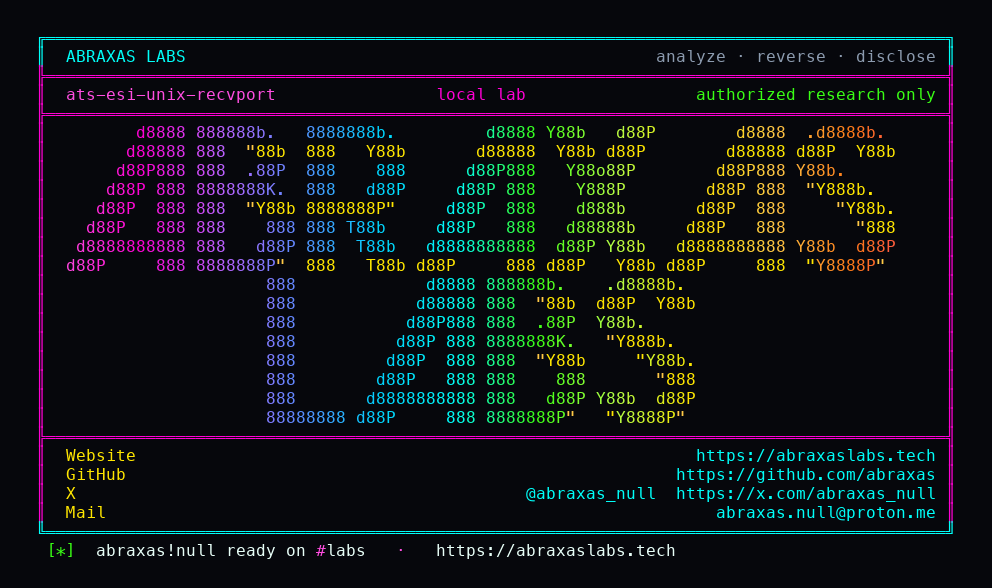

<p align="center">
  
</p>

<p align="center">
  <a href="https://abraxaslabs.tech"><strong>abraxaslabs.tech</strong></a>
  &nbsp;·&nbsp;
  <a href="https://github.com/abraxas">github.com/abraxas</a>
  &nbsp;·&nbsp;
  <a href="https://x.com/abraxas_null">@abraxas_null</a>
  &nbsp;·&nbsp;
  <a href="mailto:abraxas.null@proton.me">abraxas.null@proton.me</a>
  &nbsp;·&nbsp;
  <a href="https://github.com/abraxas/ats-esi-unix-recvport">ats-esi-unix-recvport</a>
</p>
<p align="center">
  Write-up: <a href="https://abraxaslabs.tech/research/ats-esi-unix-recvport"><strong>https://abraxaslabs.tech/research/ats-esi-unix-recvport</strong></a>
</p>


# ats-esi-unix-recvport

**Class:** SSRF
**Reach:** Remote

**Apache Traffic Server** `10.2.0` (`b1df7334`) - Apache Software Foundation

ESI FetchSM PluginVC reports dest port **0**. Remap treats port 0 as UDS and rewrites the include scheme to `http+unix` so it matches `map_with_recv_port http+unix://` rules meant only for UDS listeners. A public-looking `esi:include` of `http://www.example.com/secret` then hits the unix-socket origin. TCP `GET /secret` stays on the TCP map. CONTROL without the unix recv-port map inlines the TCP origin (no witness). Include scheme `http+unix` itself is `BAD_SCHEME` in the July 2026 validator.

Typical `esi.so` plus one `map` does not hit this. Needs ESI plus at least one `map_with_recv_port http+unix://` line. Default `remap_required: 1` and `number_of_redirections: 0`.

This is not CVE-2026-58178 (private literals, `file://`, nested comments, depth cap closed).

| | |
|---|---|
| ID | no CVE yet |
| Class | **SSRF** |
| Reach | **Remote** (unauthenticated HTTP to an ESI vhost) |
| CWE | [CWE-918](https://cwe.mitre.org/data/definitions/918.html) |
| CVSS | **High: 8.6** `CVSS:3.1/AV:N/AC:L/PR:N/UI:N/S:C/C:H/I:N/A:N` |
| Product | [Apache Traffic Server](https://github.com/apache/trafficserver) |
| Affected | **10.2.0** (`b1df7334b39a878971c376da849e8da4984918b6`) ESI plus `map_with_recv_port http+unix` |
| Auth | none. ESI plugin. Recv-port unix map. |
| License | [GNU Affero GPL v3.0](LICENSE) |
| Lab | `127.0.0.1:18750` / `18751` only. Image `ats-10.2.0-lab:local`. |

I pinned tag [10.2.0](https://github.com/apache/trafficserver/releases/tag/10.2.0), commit [`b1df7334b39a878971c376da849e8da4984918b6`](https://github.com/apache/trafficserver/commit/b1df7334b39a878971c376da849e8da4984918b6). Source-built image.

## What an attacker can do

Unauth HTTP to an ESI vhost whose remap has `map_with_recv_port http+unix://`. Include `src` the attacker can influence (compromised origin, stored ESI, or `$(HTTP_HEADER{...})`).

| Method | Sink | Privilege |
|---|---|---|
| Unauth `GET /page` ESI include `http://www.example.com/secret` | FetchSM dest port 0 matches `map_with_recv_port http+unix://www.example.com/` ([`RemapProcessor.cc:87-114`](https://github.com/apache/trafficserver/blob/b1df7334b39a878971c376da849e8da4984918b6/src/proxy/http/remap/RemapProcessor.cc#L87-L114), [`PluginVC.h:274-278`](https://github.com/apache/trafficserver/blob/b1df7334b39a878971c376da849e8da4984918b6/include/proxy/PluginVC.h#L274-L278)) | **Recon / SSRF (lab-proven):** client body inlined `ATS-ESI-UNIX-RECVPORT-WITNESS` from the UDS origin. |
| Same | first-order write / shell | **Integrity: none.** No first-order write. No shell. |
| CONTROL `GET /page` without unix recv-port map | TCP origin include | **Closed (lab-proven):** inlines `TCP-ORIGIN-OK`, no witness. |
| TCP client `GET /secret` on the poc vhost | TCP map | **Closed (lab-proven):** `TCP-ORIGIN-OK`, no witness. |

**Lab-proven vs inferred:** control no witness, poc page witness, poc TCP `/secret` no witness: lab. Influencing `src` via stored ESI or header expansion is the documented ESI trust model, not re-proven here. The lab include is a static `http://www.example.com/secret` on `/page`.

**Requires:** ESI plugin plus `map_with_recv_port http+unix`. Default `remap_required: 1`. `number_of_redirections: 0`.

## Adjacent surface that stays closed

| Surface | Lab |
|---|---|
| CONTROL without unix recv-port map | `control-no-witness=yes`, inlines `TCP-ORIGIN-OK` |
| TCP client `GET /secret` | `poc-tcp-secret-no-witness=yes` |
| Include scheme `http+unix` | validator `BAD_SCHEME` |
| `file://`, private literals, nested comments, depth cap | CVE-2026-58178 closed |
| Hostname denylist without DNS | documented; dead on `remap_required: 1` |
| `remap_required: 1` miss | 404 |
| `number_of_redirections: 0` | Location follow off |

## How I found it

`PluginVCCore` zeros `passive_addr_struct`. `PluginHttpConnectInternal` sets only `active_addr` (the original client). FetchSM's HttpSM runs on the **passive** PluginVC. `attach_client_session` copies `netvc->get_local_addr()` into `client_info.dst_addr`. Passive local addr is the zeroed struct. `host_order_port()` is 0.

Remap lookup ([`RemapProcessor.cc:87-114`](https://github.com/apache/trafficserver/blob/b1df7334b39a878971c376da849e8da4984918b6/src/proxy/http/remap/RemapProcessor.cc#L87-L114)): port 0 means UDS. Scheme is rewritten `http` -> `http+unix` so `map_with_recv_port http+unix://` matches. Unit test `test_RemapRules.cc:237-240` documents that.

The July validator rejects include scheme `http+unix`. It does not reject an `http://` include whose **internal** remap hop became unix because dest port was 0.

Wrong turns: treating typical `esi.so` + one `map` as this leftover (CONTROL proves it is not); filing hostname denylist without DNS (documented, dead on remap_required=1); claiming `file://` still works; expecting TCP `/secret` to follow the unix map.

Theatre: a reverse shell. The oracle is an inlined witness from the UDS origin, with TCP `/secret` still TCP.

## Lab

```bash
python3 ats-esi-unix-recvport-Abraxas-Labs.py
```

or

```bash
cd lab
./run.sh
```

Loopback poc `127.0.0.1:18750`, control `127.0.0.1:18751`. Compose project `ats-esi-unix-recvport`. Image `ats-10.2.0-lab:local`. Witness `ATS-ESI-UNIX-RECVPORT-WITNESS`. Last line:

```
SUCCESS ats-esi-unix-recvport control-no-witness=yes poc-page-witness=yes poc-tcp-secret-no-witness=yes ATS-ESI-UNIX-RECVPORT-WITNESS
```

## The fix

Do not treat FetchSM PluginVC dest port 0 as a UDS recv-port match. Keep `map_with_recv_port http+unix://` for real UDS listeners. ESI includes of `http://host/` should stay on the TCP map even when an http+unix recv-port rule exists for that host.

## References

- [github.com/apache/trafficserver](https://github.com/apache/trafficserver) tag [10.2.0](https://github.com/apache/trafficserver/releases/tag/10.2.0) (`b1df7334b39a878971c376da849e8da4984918b6`)
- [`PluginVC.h`](https://github.com/apache/trafficserver/blob/b1df7334b39a878971c376da849e8da4984918b6/include/proxy/PluginVC.h) zeroed passive addr
- [`PluginHttpConnect.cc`](https://github.com/apache/trafficserver/blob/b1df7334b39a878971c376da849e8da4984918b6/src/proxy/PluginHttpConnect.cc)
- [`RemapProcessor.cc`](https://github.com/apache/trafficserver/blob/b1df7334b39a878971c376da849e8da4984918b6/src/proxy/http/remap/RemapProcessor.cc) port 0 -> `http+unix`
- [`test_RemapRules.cc`](https://github.com/apache/trafficserver/blob/b1df7334b39a878971c376da849e8da4984918b6/src/proxy/http/remap/unit-tests/test_RemapRules.cc)
- [CWE-918](https://cwe.mitre.org/data/definitions/918.html)
